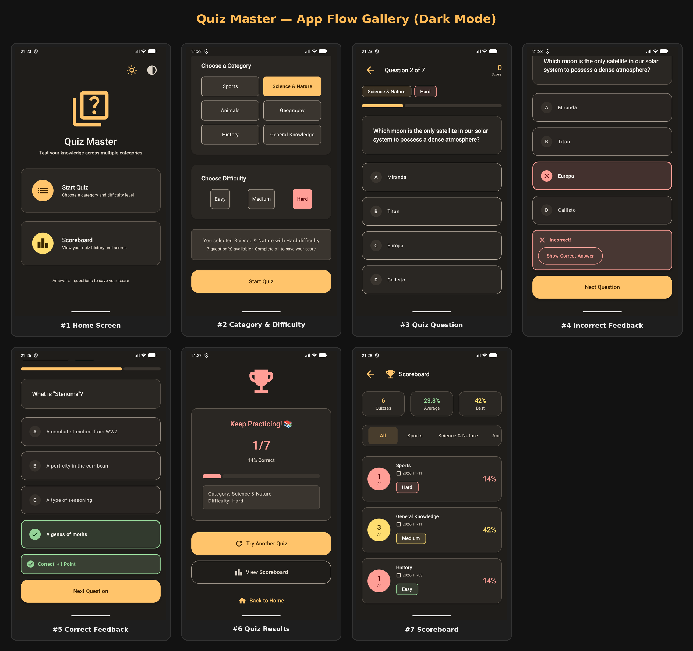
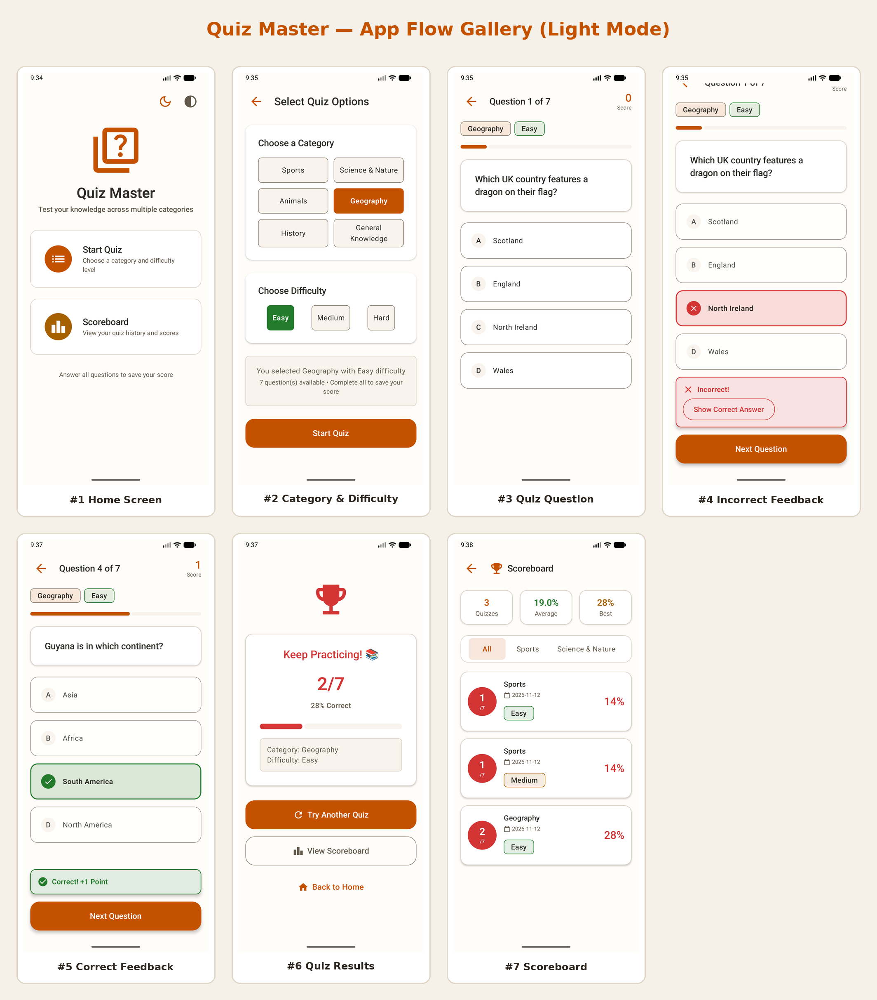

# Quiz Master

### PL

Wieloplatformowa aplikacja (Kotlin Multiplatform) na systemy Android oraz iOS pozwalająca na grę w quizy,
oparta na API [OpenTDB](https://opentdb.com/). Wykorzystuje współdzielony interfejs użytkownika (Compose Multiplatform), architekturę MVI oraz Clean Architecture.
Za komunikację sieciową odpowiada Ktor, a dane lokalne są przechowywane przy użyciu bazy danych Room KMP oraz DataStore.

### EN

Cross-platform (Kotlin Multiplatform) Android & iOS app for playing quizzes, based on the [OpenTDB](https://opentdb.com/) API.
Built with a shared UI toolkit (Compose Multiplatform), following MVI and Clean Architecture.
Uses Ktor for networking and Room KMP with DataStore for local data persistence.

### Technologie/Technologies:

* Android & iOS
* Kotlin Multiplatform (KMP)
* Compose Multiplatform (Material Design 3)
* MVI + Clean Architecture
* Navigation Compose (Type-Safe Navigation)
* Kotlin Coroutines & Flow
* Kotlinx Serialization & Datetime
* Koin (Dependency Injection)
* Ktor Client (OkHttp & Darwin)
* Room KMP (`BundledSQLiteDriver`)
* DataStore Preferences
* Ksoup (HTML Entities decode)
* Kotlin Test & Coroutines Test
* Gradle
* Git

### Android installation [APK](https://github.com/Cutter72/quiz-master-kmp/releases/download/1.0.0/androidApp-release.apk)

### Screenshots

